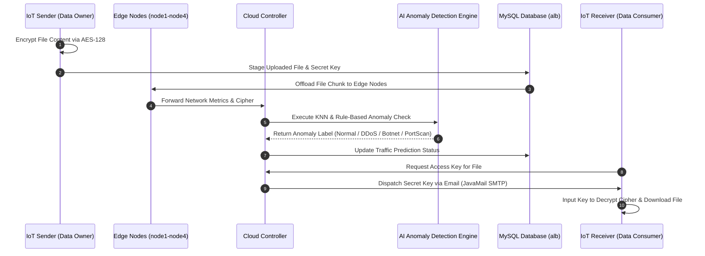

# Project Overview & Architecture Documentation

## Title
**An AI-Enabled Federated Edge-Cloud Communication Framework for Dynamic Task Offloading and Network Anomaly Detection in IoT Systems**

---

## Executive Summary
This project presents an enterprise-grade Java web application designed to solve key challenges in IoT edge-cloud communication. It integrates **dynamic task offloading** across multi-tier edge nodes with **AI-driven network anomaly detection** (identifying DDoS, Botnet, and PortScan attacks using KNN and rule-based models), **AES-128 end-to-end data encryption**, **SHA-256 blockchain verification**, and **automated SMTP key delivery**.

---

## Table of Contents
1. [Key Features](#key-features)
2. [System Architecture & Flow](#system-architecture--flow)
3. [User Roles & Functional Modules](#user-roles--functional-modules)
4. [Source Code Structure](#source-code-structure)
5. [AI & Machine Learning Engine](#ai--machine-learning-engine)
6. [Security & Cryptographic Specifications](#security--cryptographic-specifications)
7. [Database Schema Reference](#database-schema-reference)
8. [Setup, Deployment & Execution Guide](#setup-deployment--execution-guide)

---

## Key Features

- **Multi-Tier Task Offloading**: Offloads heavy tasks and file storage from IoT Senders to intermediate Edge Nodes (`node1` through `node4`) and Cloud servers based on dynamic capacity metrics.
- **Real-Time Network Anomaly Detection**: Uses metric thresholds and K-Nearest Neighbors (KNN) to analyze network traffic patterns (`duration_sec`, `packet_count`, `bytes_transferred`, `syn_packets`, `failed_logins`, etc.) and flag attacks in real-time.
- **AES-128 Symmetric Encryption**: Protects file payloads prior to network transmission, maintaining confidentiality.
- **SHA-256 Blockchain Block Integrity**: Generates cryptographic hash digests for block verification, guaranteeing data authenticity across edge nodes.
- **Automated Mail Dispatch**: Sends generated secret keys directly to authorized receiver email addresses via JavaMail SMTP.

---

## System Architecture & Flow



---

## User Roles & Functional Modules

### 1. IoT Sender (Data Owner)
- **Registration & Login**: Secure user portal (`owner.jsp`, `oreg.jsp`).
- **File Upload**: Uploads text/data files via [Upload.java](file:///c:/Users/Chetan/Documents/An%20Al-Enabled%20Federated/src/java/Efficient/Upload.java).
- **Encryption**: Automatically generates 128-bit AES keys and converts raw contents to Base64 ciphers before saving.

### 2. Edge Nodes (Offloading Layer)
- **Node Dashboard**: View offloaded files and load metrics (`node.jsp`, `chome.jsp`).
- **Load Balancing**: Distributes data chunks according to node status (`node1` to `node4`).

### 3. Cloud Server (Central Controller)
- **Cloud Administration**: View cloud data records, offloading statuses, and system metrics (`cloud.jsp`, `cloud_submit.jsp`).
- **AI Anomaly Predictor**: Invokes [NetworkAttackPredictor.java](file:///c:/Users/Chetan/Documents/An%20Al-Enabled%20Federated/src/java/Efficient/NetworkAttackPredictor.java) and [KNNClassifier.java](file:///c:/Users/Chetan/Documents/An%20Al-Enabled%20Federated/src/java/Efficient/KNNClassifier.java) to screen all incoming offloads.
- **Key Authorization**: Approves or denies decryption key requests submitted by IoT Receivers.

### 4. IoT Receiver (Data Consumer)
- **Registration & Login**: Portal for end consumers (`rec.jsp`, `recreg.jsp`).
- **Key Requests**: Submits access requests for encrypted files (`req` table).
- **Decryption & Download**: Receives secret keys via email ([mail.java](file:///c:/Users/Chetan/Documents/An%20Al-Enabled%20Federated/src/java/Efficient/mail.java)), inputs keys on [dl.jsp](file:///c:/Users/Chetan/Documents/An%20Al-Enabled%20Federated/web/dl.jsp), and recovers the original plaintext via [decryption.java](file:///c:/Users/Chetan/Documents/An%20Al-Enabled%20Federated/src/java/Efficient/decryption.java).

---

## Source Code Structure

```
An Al-Enabled Federated/
├── build.xml                                       # Ant build script
├── db.sql                                          # MySQL Database script
├── network_anomaly_dataset_records_rule_based).csv # Machine Learning Dataset
├── README.md                                       # Main repository README
├── project.md                                      # Comprehensive project guide
│
├── src/java/
│   ├── databaseconnection/
│   │   └── databasecon.java                        # Database connection factory
│   └── Efficient/
│       ├── bcdemo.java                             # SHA-256 block hashing (Blockchain demo)
│       ├── decryption.java                         # AES cipher decryption
│       ├── encryption.java                         # AES cipher encryption
│       ├── encryptimg.java                         # Image encryption handler
│       ├── Ftpcon.java                             # FTP connection handler
│       ├── Ftpcon1.java                            # Alternate FTP helper
│       ├── KNNClassifier.java                      # KNN classification algorithm
│       ├── mail.java                               # Email dispatch via SMTP
│       ├── Main.java                               # CLI execution harness
│       ├── NetworkAttackPredictor.java             # Rule-based attack predictor
│       ├── NetworkRecord.java                      # Metric feature vector structure
│       └── Upload.java                             # Multipart upload handling Servlet
│
└── web/                                            # Web Root (JSPs, HTML, CSS, JS)
    ├── index.html                                  # Web Landing Page
    ├── owner.jsp / ohome.jsp / upload.jsp          # IoT Sender pages
    ├── node.jsp / chome.jsp / nact.jsp             # Edge Node pages
    ├── cloud.jsp / cloud_submit.jsp / dataset.jsp  # Cloud Controller & AI pages
    ├── rec.jsp / rhome.jsp / dl.jsp                # IoT Receiver pages
    ├── assets/                                     # Vendor scripts, CSS stylesheets, images
    └── WEB-INF/                                    # Deployment descriptor & dependencies
```

---

## AI & Machine Learning Engine

### Rule-Based Anomaly Predictor ([NetworkAttackPredictor.java](file:///c:/Users/Chetan/Documents/An%20Al-Enabled%20Federated/src/java/Efficient/NetworkAttackPredictor.java))

Evaluates 10 real-time traffic attributes:
1. `duration_sec`
2. `packet_count`
3. `bytes_transferred`
4. `flow_rate`
5. `failed_logins`
6. `syn_packets`
7. `udp_packets`
8. `tcp_retransmissions`
9. `avg_packet_size`
10. `connection_hour`

**Classification Rules:**
- **DDoS**: Triggered when `packet_count > 2000` AND `syn_packets > 200` AND `failed_logins >= 5`.
- **Botnet**: Triggered when `duration_sec > 30` AND `packet_count > 1000` AND `bytes_transferred > 20000` AND `syn_packets < 50`.
- **PortScan**: Triggered when `500 <= packet_count <= 2000` AND `50 <= syn_packets <= 200` AND `failed_logins >= 10`.
- **Normal**: Assigned when no threat conditions are met.

### KNN Classifier ([KNNClassifier.java](file:///c:/Users/Chetan/Documents/An%20Al-Enabled%20Federated/src/java/Efficient/KNNClassifier.java))
- Implements Euclidean distance calculations over training records from [network_anomaly_dataset_records_rule_based).csv](file:///c:/Users/Chetan/Documents/An%20Al-Enabled%20Federated/network_anomaly_dataset_records_rule_based%29.csv).
- Computes $K$ nearest neighbors to determine classification via majority vote.

---

## Security & Cryptographic Specifications

- **AES-128 Encryption**: Uses Java `javax.crypto.Cipher` with `AES` mode and 128-bit key generation.
- **Base64 Encoding**: Encodes binary ciphers and key byte arrays for safe transmission in HTTP/SQL payloads.
- **SHA-256 Hash Digests**: Generates 10-character hash signatures for data blocks to establish lightweight blockchain verification across edge nodes ([bcdemo.java](file:///c:/Users/Chetan/Documents/An%20Al-Enabled%20Federated/src/java/Efficient/bcdemo.java)).
- **SMTP Email Notifications**: Utilizes `javax.mail` with TLS (`smtp.gmail.com:587`) for key distribution ([mail.java](file:///c:/Users/Chetan/Documents/An%20Al-Enabled%20Federated/src/java/Efficient/mail.java)).

---

## Database Schema Reference

The application uses MySQL database **`alb`**.

| Table Name | Description | Key Fields |
| :--- | :--- | :--- |
| `cloud` | Cloud admin accounts | `username`, `password` |
| `clouddata` | Master file records, network metrics, AI predictions | `filename`, `owner`, `cipher`, `skey`, `duration_sec`, `packet_count`, `bytes_transferred`, `syn_packets`, `prediction` |
| `node` | Edge node registry & load values | `username`, `password`, `node`, `node_value` |
| `node_data` | Data offloaded to specific edge nodes | `filename`, `owner`, `cipher`, `skey`, `node`, `status` |
| `owner` | Registered IoT Senders | `username`, `password`, `email`, `mobile`, `address` |
| `rec` | Registered IoT Receivers | `username`, `password`, `email`, `mobile`, `address` |
| `req` | File key access requests | `filename`, `owner`, `cipher`, `node`, `rec`, `status` |
| `upload` | Staging table for uploaded files | `filename`, `username`, `content`, `cipher`, `skey`, `status` |

---

## Setup, Deployment & Execution Guide

### 1. Database Configuration
- Import [db.sql](file:///c:/Users/Chetan/Documents/An%20Al-Enabled%20Federated/db.sql) into MySQL Server.
- Verify credentials in [databasecon.java](file:///c:/Users/Chetan/Documents/An%20Al-Enabled%20Federated/src/java/databaseconnection/databasecon.java) (`localhost:3306`, database `alb`, default user `root`/`root`).

### 2. IDE Setup & Deployment
- Open project in **NetBeans IDE** or **Eclipse**.
- Configure **Apache Tomcat** (v8.5+ / v9.0+) as the application server.
- Build the project (`Clean and Build`) to produce the `.war` artifact.
- Launch Tomcat and navigate to `http://localhost:8080/An_Al-Enabled_Federated/`.

---
*Created for Project Documentation & System Reference.*
